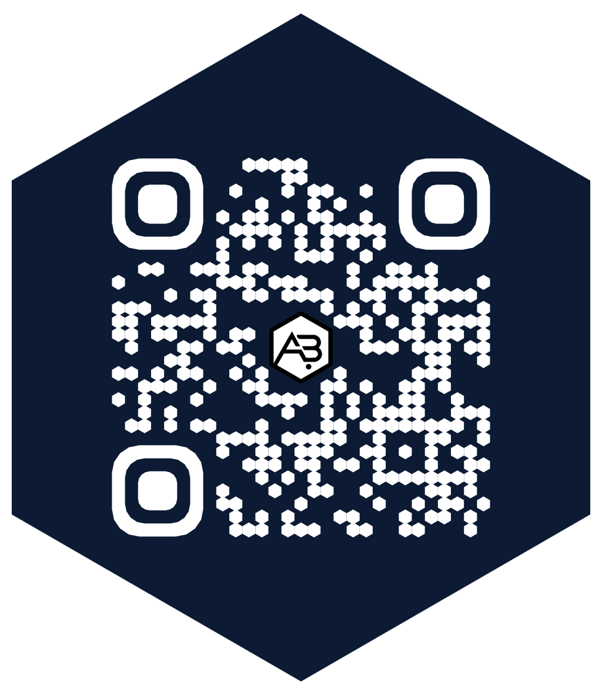

# A·BASAR QR Studio

Brand-aware QR code generator. It emits **standard ISO QR codes** — every phone,
every scanner app, every point-of-sale reader can read them — but draws the
modules as hexagons, wraps them in a circular or hexagonal frame, and drops the
A·BASAR mark in the middle.

Two front-ends, one engine: design it in the browser, reproduce it from the
command line.

<picture>
  <source media="(prefers-color-scheme: dark)" srcset="examples/hexagon-light.png">
  
</picture>

*Scan it — it resolves to `aobasar.com`. The first draft of this image did not:
it used hexagonal finder patterns and decoded at only one of five test sizes.
The tool refused to sign off on it, which is the entire point of it.*

```
index.html   browser UI — double-click to open, no install, no network
qrgen        CLI — batch generation from CSV
core.js      shared rendering engine (both front-ends use it)
png.js       dependency-free PNG writer for the CLI
test/        readability sweep + visual test board
examples/    sample output
NOTES.md     Apple App Clip Code research (why it was ruled out)
```

## Why this exists

Decorative QR codes fail quietly. A designer nudges the module shape, drops in a
logo, picks brand colours — the preview looks great, the print run goes out, and
half the scans fail in the wild. Nothing in the design tool ever said no.

So this generator **decodes its own output**. Every render is rasterised at
three sizes and pushed back through a QR decoder; the badge under the preview
tells you whether the design still works before it reaches a printer.

That feedback loop turned two design decisions into measurements rather than
opinions:

- **Hexagonal modules need to be 15% oversized.** A pointy-top hexagon covers
  only ~65% of its grid cell, versus 100% for a square — roughly a third less
  ink. At scale 1.0 codes started failing to decode; 1.15 is the smallest
  multiplier that held up across every payload tested, so it is the default.
- **Hexagonal finder patterns don't work at all.** Scanners locate a code by
  looking for the 1:1:3:1:1 dark-light ratio in the three corner markers. A
  hexagon breaks that ratio: in the sweep this setting was almost never
  readable. The option is still there, but the engine warns and the badge goes
  red. The brand language belongs in the modules; the corners should stay
  rounded.

## Browser

Open `index.html`. No build step, no server, no network access — the QR encoder,
the decoder used for testing, and the brand mark are all vendored into the repo.
Nothing you type leaves the machine.

To reach the page from a phone — the only real way to test a QR code, with a
real camera against a real screen — serve it instead:

```bash
./scripts/serve.sh          # http://localhost:9060, plus the LAN address
```

The script prints the LAN URL, refuses to start on a second port if 9060 is
taken, and disables caching so an edited `core.js` is never served from the
browser's copy. Read the comments in it before simplifying anything away.

- **Content** — URL, `tel:`, `mailto:`, wifi, vCard. The vCard template opens a
  contact form that writes a vCard 3.0 payload, leaving empty fields out. Shorter
  payloads mean fewer modules, bigger dots, and longer scan range.
- **Shape** — frame (none / circle / hexagon), module shape, finder patterns.
  Defaults: no frame, circular modules, rounded finders, no logo.
- **Colour** — brand palette presets, with a live contrast ratio. Scanners need
  tonal difference, not hue, so the hint calls out anything under 4:1.
- **Logo** — the embedded A·BASAR mark, or drag in your own SVG/PNG.
- **Readability badge** — the self-test described above.

`Save preset` writes the current design as JSON; the `CLI command` section prints
the exact command that reproduces it.
The last design is remembered in the browser; `Reset style to defaults` goes back
to the defaults and keeps the content.

## CLI

```bash
./qrgen "https://aobasar.com" --frame circle --dot hex --logo ink --out card.svg

# batch, using a preset saved from the browser
./qrgen --csv addresses.csv --outdir out/ --json preset.json --png --verify
```

Each CSV row is `text[,filename]`. `--verify` decodes every generated code and
exits with status 2 if any of them is fragile, which makes it safe to drop into
a print pipeline.

Full option list: `./qrgen --help`

## Readability rules of thumb

- **Error correction is always ECC-H** — about 30% of the code is recoverable,
  and the logo eats into that budget.
- **Keep the logo under 22%.** The UI reports the share of modules covered and
  warns past 16%.
- **Don't shrink hexagonal modules** below ×1.15 (see above).
- **Avoid hexagonal finder patterns** (see above).
- **Quiet zone**: at least 4 modules with no frame, at least 2 inside a frame.
- **Cobalt is riskier than ink.** `#2563EB` on white is 4.6:1, versus 17:1 for
  `#0C1B33`. Fine on a poster, marginal on a small sticker.
- **Test on a real phone before printing.** The self-test runs on a clean
  render; it knows nothing about paper, ink spread, glare, or distance.

## Tests

```bash
node test/sweep.js          # decodes every style combination, exits 1 on failure
open test/preview.html      # visual board, also exercises the PNG export path
```

The sweep takes a few minutes: 240 combinations across five payloads, each
decoded at five raster sizes.

## How it works

The engine computes all geometry in **module units** (1 unit = one QR module)
and converts to pixels only at serialisation time, so SVG and raster output are
guaranteed identical. Every visual element is a filled primitive painted in
order — polygon, circle, rectangle — which is what lets one shape list feed both
the SVG writer and the software rasteriser behind the readability test.

The rasteriser is deliberately pessimistic: it paints the logo as a solid opaque
block, so the test measures the worst case a scanner could face.

Anti-aliasing matters more than it looks. Without supersampling, certain
pixel-per-module ratios produced uneven module widths and the decoder drifted
off the sampling grid — codes appeared to fail at 1000px but pass at 1400px.
2× supersampling removed the artefact and made the test trustworthy.

## Dependencies

Vendored in `vendor/`, no `npm install` required at runtime:

- [qrcode-generator](https://github.com/kazuhikoarase/qrcode-generator) (MIT) — encoder
- [jsQR](https://github.com/cozmo/jsQR) (Apache-2.0) — decoder, used only for self-testing

The brand mark is embedded in `assets/logo.js` as a data URI. If the logo
changes, regenerate that file from the source SVGs.

## License

MIT — see [LICENSE](LICENSE).
